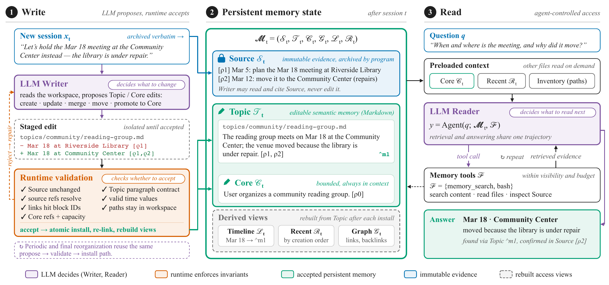

<div align="center">

<br>

<hr>

<p>
Zichuan Fu<sup>1*</sup>, Junjia Qi<sup>1*</sup>, Wenlin Zhang<sup>1</sup>, Yimin Deng<sup>1</sup>,<br>
Shirong Wang<sup>1</sup>, Jinyang Li<sup>1</sup>, Xian Wu<sup>2</sup>, Xiangyu Zhao<sup>1†</sup>
</p>

<p>
<sup>1</sup> City University of Hong Kong &nbsp; <sup>2</sup> Tencent Jarvis Lab<br>
<sup>*</sup> Equal contribution &nbsp; <sup>†</sup> Corresponding author
</p>

<h4>
<a href="https://arxiv.org/pdf/2611.11929">📄 Paper</a> &nbsp;
<a href="https://arxiv.org/abs/2611.11929">arXiv</a> &nbsp;
<a href="https://arxiv.org/html/2611.11929v1">HTML</a> &nbsp;
<a href="https://qi202.github.io/SoMem/">🌐 Project Page</a>
</h4>
</div>

## :trophy: Best Reported Results

**93.25% on LoCoMo · 90.20% on LongMemEval-S** — the highest full-set SoMem
accuracy reported in the manuscript's backbone and cross-model experiments.
These use different model configurations and are not part of the shared-Reader ranking below.

| Benchmark | LJ accuracy | Evaluation set | Writer | Reader | Configuration |
|---|---:|---|---|---|---|
| **LoCoMo** | **93.25%** | All 1,540 category 1–4 questions | GPT-5.6 Luna | Qwen 3.8 Flash | Cross-model reuse of the Writer's frozen memory |
| **LongMemEval-S** | **90.20%** | All 500 questions | DeepSeek V4 Flash | DeepSeek V4 Flash | Same-model construction and answering; up to 50 QA turns |

Both use GPT-4o-mini judging. The manuscript does not explicitly specify the
Reader reasoning-effort setting for these two configurations.

**Reader-effort experiments (fixed subsets, not full-set scores):**

| Benchmark | Best subset score | Questions | Reader | Requested effort |
|---|---:|---:|---|---|
| LoCoMo | **95.00%** LJ accuracy | 100 | GPT-6.1 Sol | xHigh |
| BEAM-100K | **70.83%** mean nugget score | 200 | Qwen 3.8 Flash | None |

Each sweep reuses constructed memory and the same questions. Its Writer is not
identified in the manuscript's scaling table or accompanying text. See
[model configurations and result provenance](docs/results.md#best-reported-configurations)
for the evidence and reporting scope. These manuscript results have not been rerun with the public recipes.

<div align="center">
<a href="docs/assets/somem-overview.pdf"></a>
</div>

Figure 1. Overview of SoMem. The Writer revises Topic documents, including Core in
`topics/core.md`. The runtime validates edits and derives Graph, Timeline, and Recent
views. The Reader starts with Core, Recent, and a file inventory, then searches and
reads documents, following links to original Source evidence as needed.

## :sparkles: Highlights

📝 **The agent organizes its own memory through ordinary documents.** It decides what
to summarize, how to group related information, and when to revise existing topics.

🔗 **Every summary stays linked to original evidence.** Source records preserve both
sides of the dialogue, so the Reader can inspect details omitted from summaries.

✅ **Memory updates are validated before acceptance.** The runtime checks document
structure and references, then rebuilds relational, temporal, and recent-memory views.

🔄 **Constructed memory can be reused across models.** Writer and Reader models can
be configured independently and use the same saved memory workspace.

🎯 **SoMem outperforms the strongest compared baseline by 2.66, 3.10, and 2.00
percentage points** on LoCoMo, BEAM-100K, and LongMemEval-S, respectively.

## :bar_chart: Shared-Reader Comparison

Results (%) with the shared GPT-6 Luna Reader and GPT-4o-mini judge.
All memory methods use GPT-6 Luna for both Writer and Reader, with no Reader reasoning effort.
LoCoMo and LongMemEval-S report LLM-judge accuracy; BEAM-100K reports mean nugget score.

| Method | LoCoMo | BEAM-100K | LongMemEval-S |
|---|---:|---:|---:|
| Full Context | 84.22 | 50.92 | 65.80 |
| A-Mem | 60.06 | 50.51 | 62.80 |
| Mem0 | 80.32 | 49.00 | 72.80 |
| MemoryOS | 56.23 | 47.96 | 53.00 |
| Nemori | 72.53 | 47.96 | 66.40 |
| LightMem | 77.99 | 43.54 | 74.50 |
| E-mem | 86.30 | 43.36 | 65.20 |
| **SoMem** | **88.96** | **54.02** | **76.50** |
| **Gain over the strongest comparator (pp)** | **+2.66** | **+3.10** | **+2.00** |

See [evaluation settings and result sources](docs/results.md) for question counts,
Writer settings, and additional configurations. These are the manuscript results;
the public recipes have not yet been used to rerun and verify them.

## :rescue_worker_helmet: Installation

Use **Python 3.12+** and an isolated environment:

```bash
git clone https://github.com/Qi202/SoMem.git
cd SoMem
python3.12 -m venv .venv
source .venv/bin/activate
python -m pip install -e .
```

On Windows PowerShell, activate with `.venv\Scripts\Activate.ps1`.
Installation includes the model SDKs and embedding stack. See
[installation and troubleshooting](docs/getting-started.md) for environment details.

## :rocket: Quick Start

The [live example](examples/live_demo.py) builds memory from the supplied
[conversation](examples/conversation.json) and answers a question from the saved
workspace. Configure an OpenAI-compatible model endpoint in `.env.example`:

```bash
cp .env.example .env
# Fill in SOMEM_BASE_URL, SOMEM_API_KEY, and SOMEM_WRITER_MODEL in .env.
# Optional SOMEM_READER_* settings select a separate Reader.
set -a
source .env
set +a

python examples/live_demo.py --dry-run
python examples/live_demo.py --workspace live-demo-memory
```

The sample asks **“What drink does Alice prefer?”** The expected answer identifies
**jasmine tea**; wording depends on the model. The run saves original Sources,
organized Topics, derived views, and the answer with its tool trace. The real run
makes provider calls; `--dry-run` checks configuration without calling a model.
Use a new workspace for each run. See the [complete walkthrough](docs/getting-started.md#model-driven-example)
for output locations and environment setup.

For an example without a model API key, see the [offline walkthrough](docs/getting-started.md#offline-workspace-example).

## :minidisc: Data Preparation

The public runner supports LoCoMo, BEAM-100K, BEAM-1M, and LongMemEval-S.
Download the benchmark data separately; the [benchmark guide](docs/benchmarks/README.md)
describes the supported input formats and configurations.

For LoCoMo, convert the downloaded conversations to the runner's input format:

```bash
python -m pip install -e '.[benchmarks]'
mkdir -p work
somem-benchmark prepare --benchmark locomo --input /path/to/locomo10.json --output work/locomo.json
```

## :checkered_flag: Evaluation

After configuring `SOMEM_BASE_URL` and `SOMEM_API_KEY`, build memory and answer the
questions. Judging uses GPT-4o-mini and requires `OPENROUTER_API_KEY` separately.

```bash
somem-benchmark build --input work/locomo.json --output work/locomo-memory --workers 1
somem-benchmark qa --input work/locomo.json --memory-root work/locomo-memory --output work/locomo-qa --workers 1
somem-benchmark judge --benchmark locomo --answers work/locomo-qa --output work/locomo-judged
```

Use new output directories: the runner saves per-question answers and scores but
does not automatically resume runs or aggregate final tables. See the
[benchmark guide](docs/benchmarks/README.md) for the other benchmarks and
[result provenance](docs/results.md#public-recipes-and-historical-results) for
differences between public recipes and historical manuscript configurations.

## :file_folder: Repository Structure

```text
code/src/                 memory construction, document format, retrieval, and runtime
code/somem/               public API, CLI, MCP server, and benchmark runner
code/somem/protocol_data/  bundled benchmark configurations
code/tests/               framework tests
examples/                 live and offline examples, sample conversations
scripts/                  release and validation utilities
docs/                     user guides, evaluation protocols, and paper figures
```

For use in an existing agent, see the [Python API](docs/python-api.md) and
[MCP integration](docs/mcp.md). The [documentation index](docs/README.md) covers
configuration, memory layout, and development.

## :+1: Acknowledgements

We thank the authors of LoCoMo, BEAM, and LongMemEval for their benchmarks.
The evaluation tools include scoring code from
[LightMem](https://github.com/zjunlp/LightMem) and a BEAM rubric-nugget protocol
derived from [Mem0](https://github.com/mem0ai/mem0). See the
[scoring provenance](code/somem/evaluation_sources/NOTICE.md) and
[snapshot attribution](code/somem/evaluation_sources/pinned/NOTICE.md) for details.

## :memo: Citation

If you find SoMem useful in your research, please cite [our paper](https://arxiv.org/abs/2611.11929):

```bibtex
@article{fu2026somem,
  title   = {Can LLM Agents Organize Their Own Memory?},
  author  = {Fu, Zichuan and Qi, Junjia and Zhang, Wenlin and Deng, Yimin and
             Wang, Shirong and Li, Jinyang and Wu, Xian and Zhao, Xiangyu},
  journal = {arXiv preprint arXiv:2611.11929},
  year    = {2026},
  eprint  = {2611.11929},
  archivePrefix = {arXiv},
  primaryClass  = {cs.AI},
  url     = {https://arxiv.org/abs/2611.11929}
}
```

## License

MIT (see [LICENSE](LICENSE)). Bundled third-party scoring code retains its own
attribution and license notices.
