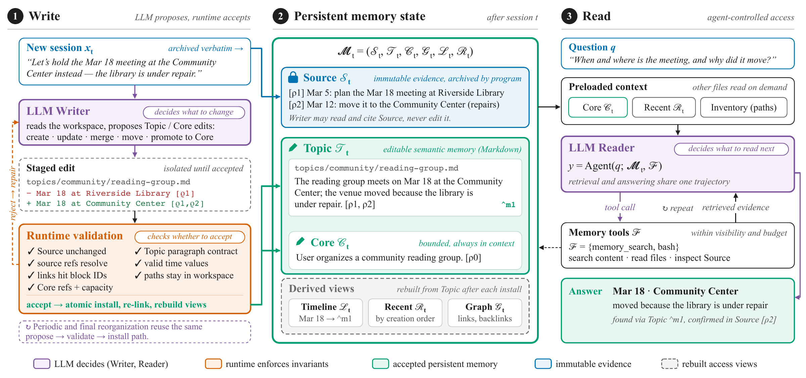

# SoMem: Self-Organized Document Memory

Persistent, document-based memory for agents. SoMem keeps original conversations
as immutable Sources, lets a Writer organize cited Markdown documents, and gives
a Reader tools to find and verify relevant evidence.

[Get started](docs/getting-started.md) · [Python API](docs/python-api.md) ·
[MCP integration](docs/mcp.md) · [Configuration](docs/configuration.md) ·
[Runtime support](docs/agent-runtime-support.md) · [Development](CONTRIBUTING.md)

[](docs/assets/somem-overview.pdf)

## What SoMem provides

- **Readable memory:** editable Topics with stable references to original Sources; bounded Core lives in `topics/core.md`.
- **Validated updates:** transactions check document structure and references before installing edits and rebuilding access views.
- **Flexible reading:** lexical and semantic retrieval, source inspection, and separate Writer/Reader models sharing one workspace.
- **Agent integration:** Python API, workspace CLI, and stdio MCP server with six memory tools and optional workspace layers.

## Benchmark performance

Best observed results across evaluated configurations on the complete benchmark sets:

| Benchmark | Metric | Best score (%) | Questions |
|---|---|---:|---:|
| LoCoMo | LJ accuracy | **93.25** | 1,540 |
| LongMemEval-S | Accuracy | **90.20** | 500 |
| BEAM-100K | Mean nugget score | **61.19** | 400 |
| BEAM-1M | Mean nugget score | **63.24** | 700 |

All scores use GPT-4o-mini judging. BEAM scores are mean rubric scores multiplied
by 100; the BEAM-100K result uses the w/o Derived configuration.

## Install

Use Python **3.12+**. From a source checkout:

```bash
git clone https://github.com/Qi202/SoMem.git
cd SoMem
python3.12 -m venv .venv
source .venv/bin/activate
python -m pip install -e .
somem --help
```

This installs the framework and runtime dependencies, including the embedding
stack. A model API key is only needed for model-driven writing or answering.
See [installation and troubleshooting](docs/getting-started.md).

## Try it without an API key

```bash
python examples/offline_demo.py --workspace demo-memory
somem validate --workspace demo-memory
```

The demo commits a cited preference, retrieves it with BM25, and prints the saved
document and source reference. It uses real transaction and search code with a
manually supplied Topic edit. There are no model calls or embedding-model
downloads. The first tokenizer use may download its encoding table. Choose a new
workspace for each run.

For model-driven **conversation → memory → answer**, follow the
[live example](docs/getting-started.md#model-driven-example), with separate
Writer/Reader settings and a `--dry-run` input check.

## Connect an agent through MCP

Add this entry to your MCP client, using absolute paths:

```json
{
  "mcpServers": {
    "somem": {
      "command": "/absolute/path/to/SoMem/.venv/bin/somem",
      "args": ["mcp", "--workspace", "/absolute/path/to/memory", "--git-commit", "off"]
    }
  }
}
```

Tools: `memory_status`, `memory_list`, `memory_read`, `memory_grep`,
`memory_search`, `memory_update`. The server uses the host agent's model; it does
not start another model. See [MCP tools and layers](docs/mcp.md).

## Memory layout

```text
memory/
  sources/             immutable conversation records
  topics/              editable semantic documents
    core.md            bounded context
  recent_events.jsonl  derived recent-event view
  timeline/            derived temporal views
  relations.json       derived relation view
  .somem/              local implementation state
```

Derived views are rebuilt from accepted documents. They are access structures,
not independent factual sources. Legacy root-level `core.md` remains supported.

## Documentation

| Guide | Contents |
|---|---|
| [Getting started](docs/getting-started.md) | Installation, offline/live examples, troubleshooting |
| [Python API](docs/python-api.md) | Transactions, construction, reading and return values |
| [Configuration](docs/configuration.md) | Credentials, models, effort and budgets |
| [Loadable benchmark protocols](docs/benchmarks/README.md) | Four public recipes, Python loader and reproduction status |
| [Benchmark Reader settings](docs/benchmarks/reader-settings.md) | Split search, directory scope and per-dataset turn budgets |
| [LoCoMo protocol](docs/benchmarks/locomo.md) | Confirmed dataset, Writer/Reader settings, scoring and reproduction workflow |
| [CLI and MCP](docs/mcp.md) | Commands, client configuration, tools and layers |
| [Runtime support](docs/agent-runtime-support.md) | Adapters and validation boundaries |
| [Release scope](docs/release-scope.md) | Public snapshot and deferred experiment material |
| [Local validation](docs/validation.md) | Checks passed and remaining validation boundaries |
| [Contributing](CONTRIBUTING.md) | Tests, documentation and packaging |

## Project status

This is the `0.1.0` framework line. The public core was synchronized on
2026-10-15, followed by Topic-first and runtime-selection updates on 2026-10-17.
Current local experiments use additional changes. This is not yet a
verified reproduction of historical paper scores. Dataset adapters, batch
entry points and pinned Judge adapters are available in the
[benchmark guide](docs/benchmarks/README.md).

The live example is a usage recipe, not verified support for every provider.
See [runtime support](docs/agent-runtime-support.md). A package version here does
not imply a PyPI release or a published Git tag.

## License and citation

SoMem is distributed under the [MIT License](LICENSE). Dependencies retain their
own licenses.

Until paper metadata is finalized, cite the repository URL and the commit used.
Paper citation metadata will be added when finalized.
